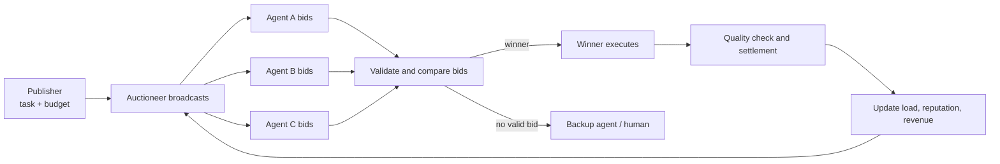

# Market Auction Multi-Agent Scheduler

A Python simulation of task allocation by auction. Tasks are posted with a budget and a quality floor, a few agents with different costs, latency and skills bid on them, and the auctioneer picks a winner before the task is paid out. No dispatcher assigns work by hand.

Based on this article (Chinese): [市场拍卖式架构](https://blog.csdn.net/qq_67069922/article/details/171152444).

## Overview

Each round posts tasks, collects bids, picks a winner and settles the result. Agents that are busy quote higher, so load spreads out on its own. Agents that bid below their own cost, or can't meet the quality floor, are filtered out before the auction.



What is in the file:

- Four bidding agents plus one backup. Unit cost runs from 0.9 to 3.2, latency from 1.2 to 8 seconds, and each agent has weak spots.
- A bid is built from base cost, load congestion, latency and a quality premium. Load enters as a square, so a busy agent prices itself out quickly.
- Three auction rules: lowest price, Vickrey (second price) and weighted scoring.
- Bid checks: missing skill, low reputation, quality below the task floor, over budget, or below 85% of declared cost.
- Rework on bad delivery: 60% payment, a reputation hit, and a re-auction next round.
- Fallback to the backup agent at 1.6x cost, then human handoff if the backup is saturated.
- A fixed seed reproduces the same run.

## Requirements


The scheduler only uses the standard library. `matplotlib` is for charts and can be skipped with `--no-chart`.

## Project structure

```
市场拍卖式架构/
├── market_auction.py        # engine and command line entry
├── test_market_auction.py   # unit tests
├── requirements.txt
├── readme.md                # English docs
├── readme_CN.md             # Chinese docs
└── output/                  # charts after a run
```

## Usage

```bash
python -m pip install -r requirements.txt
python market_auction.py
```

Pick one mechanism, change the horizon or seed:

```bash
python market_auction.py --mechanism 综合评分 --rounds 40 --seed 2026
python market_auction.py --no-chart
```

| Option | Default | Description |
| --- | --- | --- |
| `--rounds` | `24` | Number of rounds |
| `--seed` | `20261126` | Random seed |
| `--mechanism` | `对比` | `最低价`, `维克里`, `综合评分` or `对比` |
| `--no-chart` | off | Tables only, no PNG output |

On Windows, run `chcp 65001` first if the console shows garbled Chinese.

## Rules

```
base_cost    = workload × unit_cost
load_cost    = base_cost × load² × 0.85
latency_cost = latency_seconds × 0.35 × workload
quality_cost = base_cost × (quality − 0.5) × 0.35
price        = (base_cost + load_cost + latency_cost + quality_cost) × (1 + noise)
```

A bid is rejected when the skill is missing, reputation is under 0.55, predicted quality is under the task floor, price is over budget, or price is under 85% of declared cost.

Auction rules:

- Lowest price: cheapest valid bid wins and pays its own price.
- Vickrey: cheapest valid bid wins and pays the second-lowest price. With one bid it pays its own.
- Weighted scoring: price, quality, latency and reputation are normalized and weighted 0.40 / 0.25 / 0.15 / 0.20.

Settlement: a delivery that clears the floor is paid in full. Otherwise it gets 60%, loses reputation and is re-auctioned next round, at most twice. An empty auction goes to the backup agent; if the backup is over 0.9 load, the task goes to a human. Each round releases part of the old load to model tasks being digested.

Thresholds and weights are `V_*` constants at the top of `market_auction.py`.

## Sample run

With the default seed and 24 rounds there are 53 tasks. Under weighted scoring, 39 are delivered first time, 5 go through rework and 14 fall back to the backup, for a total payment of 1231.08 and average quality of 0.789. Lowest price pays 1143.96 in total, Vickrey 1193.14. Most fallbacks are image recognition and code repair, where only one agent can clear the quality floor.

Numbers move with the seed, so run it yourself for a given scenario.

## Tests

```bash
python -m unittest test_market_auction.py -v
```

19 cases covering bid checks, the three auction rules, settlement and rework, fallback and human handoff, anti-gaming penalties and seed reproducibility.

## Contributing

Issues and pull requests are welcome. Keep changes small, run the tests before submitting, and explain the scenario behind a new rule so the auction stays readable.

## Contact

谙弆悕博士（Ailan Anjuxi）

📫 Email: anjuxi.ME@outlook.com

📞 SIP: `sip:anjuxi@sip.linphone.org`

GitHub: <https://github.com/anjuxi>

> © 2026 谙弆悕博士（Ailan Anjuxi），All rights reserved.
