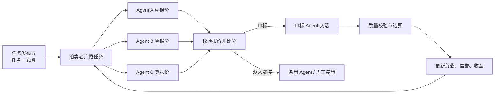

# 市场拍卖式多智能体任务调度

用 Python 写的一个小仿真：任务挂出来拍卖，几个能力不同的 Agent 各自报价，价低或综合分高的接单，交付后再结算。没有主管节点，任务分给谁由竞价决定。

配套文章：[多智能体架构详解：市场拍卖式架构](https://blog.csdn.net/qq_67069922/article/details/171152444)。

## 项目介绍

市场拍卖式架构把任务当成服务来交易。发布方给出预算和质量门槛，Agent 算一算自己的成本、负载和时延，报个价；拍卖者收齐报价后按规则选人。整个过程是发布、报价、中标、结算四步，一轮接一轮。



代码里主要有这些：

- 四个竞标 Agent 加一个备用。单位成本从 0.9 到 3.2，时延从 1.2 秒到 8 秒，技能各有短板，不是同质节点。
- 报价包含基础成本、负载拥堵、时延折算和质量溢价。负载按平方计入，Agent 越忙报价越贵。
- 三种拍卖方式：最低价、维克里（第二价格）、多维加权评分。
- 报价先过校验：没技能、信誉低、质量预估不够、超预算、低于成本 85% 的都会驳回。
- 质量不达标要返工：只结六成报酬、扣信誉，任务下一轮重拍。
- 没人投标时备用 Agent 按 1.6 倍成本接单，备用也过载就转人工。
- 随机种子固定后，结果可以完整复现。

## 依赖说明


调度逻辑只用标准库，`matplotlib` 是画图用的。加 `--no-chart` 就不需要装它。

## 项目结构

```
市场拍卖式架构/
├── market_auction.py        # 仿真引擎与命令行入口
├── test_market_auction.py   # 单元测试
├── requirements.txt
├── readme.md                # 英文说明
├── readme_CN.md             # 中文说明
└── output/                  # 运行后生成的图表
```

## 使用说明

```bash
python -m pip install -r requirements.txt
python market_auction.py
```

换机制、轮次和种子：

```bash
python market_auction.py --mechanism 综合评分 --rounds 40 --seed 2026
python market_auction.py --no-chart
```

| 参数 | 默认值 | 说明 |
| --- | --- | --- |
| `--rounds` | `24` | 模拟轮次 |
| `--seed` | `20261126` | 随机种子 |
| `--mechanism` | `对比` | `最低价`、`维克里`、`综合评分`、`对比` |
| `--no-chart` | 关闭 | 只打表格，不出图 |

Windows 控制台如果中文乱码，先执行 `chcp 65001`。

## 规则

报价这么算：

```
基础成本 = 工作量 × 单位成本
负载成本 = 基础成本 × 负载² × 0.85
时延成本 = 响应秒数 × 0.35 × 工作量
质量成本 = 基础成本 × (质量 − 0.5) × 0.35
报价     = (基础成本 + 负载成本 + 时延成本 + 质量成本) × (1 + 抖动)
```

以下情况报价无效：技能表里没有对应能力、信誉低于 0.55、预估质量低于任务门槛、报价超过预算、报价低于申报成本的 85%。

拍卖规则：

- 最低价：有效报价里最便宜的拿单，按自己的报价结算。
- 维克里：最低价拿单，按第二低价结算；只有一家投标就按自家报价。
- 综合评分：价格、质量、时延、信誉归一化后加权，默认 0.40 / 0.25 / 0.15 / 0.20。

结算规则：质量达标拿全款；不达标只拿六成、扣信誉、顺延一轮重拍，最多两次；无人投标走备用 Agent，备用过载转人工。每轮开始会释放一部分历史负载，模拟任务被慢慢消化。

所有阈值和权重都是文件顶部的 `V_*` 常量，调参不用改逻辑。

## 默认参数下的结果

默认种子 20261126、24 轮，一共 53 个任务。综合评分机制下 39 单一次交付、5 次返工、14 单走了备用，总报酬 1231.08，平均质量 0.789；最低价机制总报酬 1143.96，维克里 1193.14。兜底集中在图像识别和代码修复这类只有单一 Agent 能达标的任务上，基本是技能瓶颈造成的。

换种子数字会变，具体以自己跑出来的为准。

## 测试

```bash
python -m unittest test_market_auction.py -v
```

19 个用例，覆盖报价校验、三种拍卖规则、结算返工、备用兜底、人工接管、恶意报价扣分和同种子复现。

## 贡献指南

提 Issue 或 PR 都行。改动尽量小，提交前跑一遍测试；如果加新的拍卖规则或评分维度，说明里写清楚对应的场景，别让规则越堆越难读。

## 联系作者

谙弆悕博士（Ailan Anjuxi）

📫 邮箱：anjuxi.ME@outlook.com

📞 SIP 电话：`sip:anjuxi@sip.linphone.org`

GitHub：<https://github.com/anjuxi>

> © 2026 谙弆悕博士（Ailan Anjuxi），All rights reserved.
